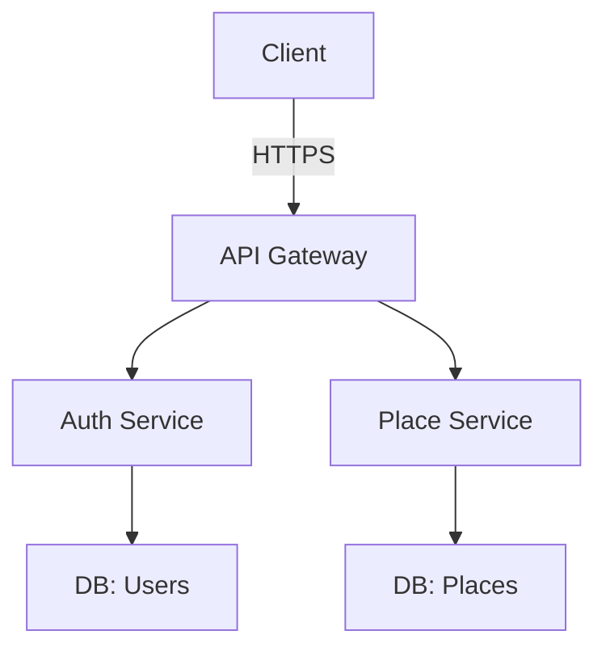
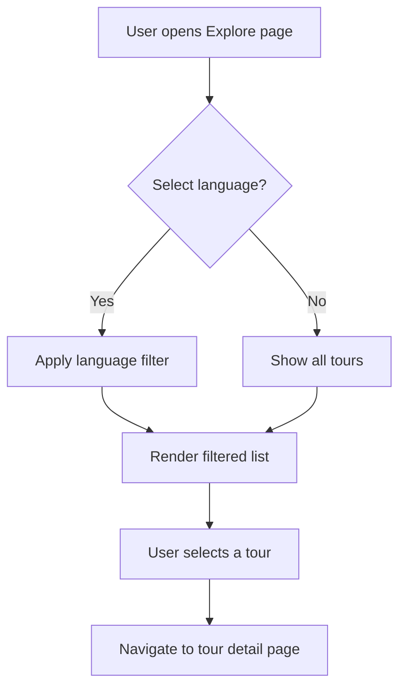
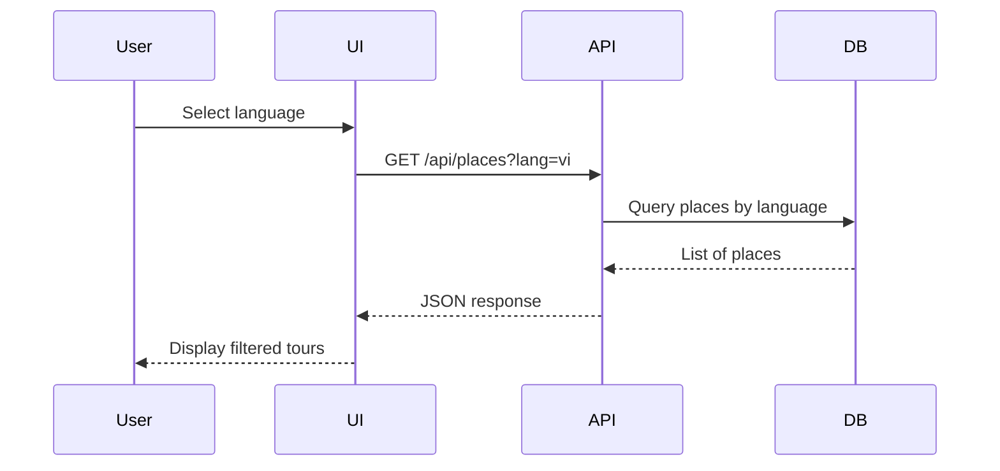
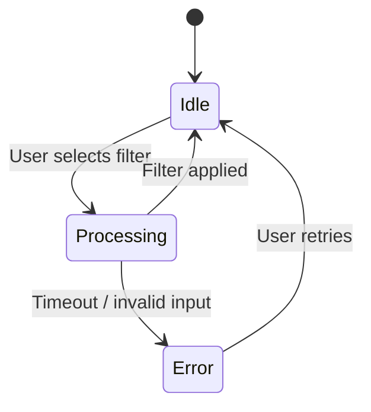

# TourVoice – Report & PRD Update Template

**Project:** TourVoice  
**Version:** 1.0  
**Last Updated:** {{DATE}}

> This file serves as a single source of truth for updating the **Software Engineering Report** and the **Product Requirements Document (PRD)** whenever a new feature is implemented or an existing function is modified.  
> All diagrams are expressed using **Mermaid** syntax so they can be rendered by GitHub, GitLab, VS Code, or any Mermaid‑compatible viewer. Replace the placeholder `{{DATE}}` with the actual date before sharing.

---

## 1. Change Log

| ID | Description | Impacted Artifact(s) | Author | Date |
|----|-------------|----------------------|--------|------|
| CL‑001 | Example: Added "Language Filter" feature to the search page | Report §3.2, PRD §4.3, UC‑005, Activity‑Diagram, Sequence‑Diagram, State‑Machine, Screen‑Design | {{AUTHOR}} | {{DATE}} |
| ... | ... | ... | ... | ... |

---

## 2. Report Updates (Sofware Engineering Report)

> Refer to the existing PDF **Sofware_Engineering_Report.pdf** for section numbers and formatting. Below are the sections most commonly affected by code changes. Replace the placeholder text with your updates.

### 2.1. Overview
_(Summarize the purpose of the change, its business value, and high‑level architecture impact.)_

### 2.2. System Architecture
- **Modified components:** _(list DLLs, services, APIs affected)_
- **Diagram update:** Update the **System Architecture** diagram (mermaid or draw.io) if data flows or component boundaries change.



### 2.3. Data Model
| Entity | New/Changed Fields | Reason | Impact on DB Migration |
|--------|-------------------|--------|------------------------|
| User | `preferred_language` (VARCHAR 10) | Support language selection in UI | Add column, default `'en'` |
| Place | `average_rating` (FLOAT) | Cached rating for performance | Computed column, back‑fill script |

### 2.4. API Contracts
| Endpoint | Method | New/Modified Params | Response Changes | Notes |
|----------|--------|---------------------|------------------|-------|
| `GET /api/places/{id}` | GET | – | Added `rating` field | …

### 2.5. Test Coverage
- Add/Update unit tests for the new functionality.
- Update integration test suites if API contracts change.

### 2.6. Deployment Notes
- Migration script version: `vX.Y.Z`
- Docker image tag: `tourvoice/api:vX.Y.Z`
- Checklist: ☐ DB migration ☐ Seeding data ☐ Smoke test

---

## 3. PRD Updates (Product Requirements Document)

> Reference the existing **PRD TourVoice – Quận 6.docx** for the original wording. Use the tables below to record new requirements or modifications.

### 3.1. Feature Summary
| Feature ID | Title | Description | Business Value | Status |
|------------|-------|-------------|----------------|--------|
| FR‑001 | Language Filter | Allow users to filter tours by language | Improves usability for non‑English speakers | ✅ Planned |
| ... | ... | ... | ... | ... |

### 3.2. User Stories
| ID | As a … | I want … | So that … | Acceptance Criteria |
|----|--------|----------|-----------|--------------------|
| US‑001 | Tourist | Filter tours by language | See only tours I can understand | 1. UI shows language dropdown<br>2. Results respect the selection |
| ... | ... | ... | ... | ... |

### 3.3. Functional Requirements
| Req ID | Requirement | Priority | Related Diagrams |
|--------|-------------|----------|------------------|
| RF‑010 | The system shall display a language selector on the *Explore* page | High | UC‑005, Activity‑Diagram‑001 |
| ... | ... | ... | ... |

### 3.4. Non‑Functional Requirements
| Req ID | Requirement | Target |
|--------|-------------|--------|
| NF‑001 | Response time for place search ≤ 500 ms (p95) | …
| ... | ... | ... |

### 3.5. Diagrams

#### 3.5.1. Use Case Diagram
```mermaid
usecase
    actor Customer
    actor Admin
    system TourVoice
    Customer --> (Filter tours)
    Customer --> (View tour details)
    Admin --> (Manage languages)
    Admin --> (Approve tours)
```

#### 3.5.2. Activity Diagram


#### 3.5.3. Sequence Diagram


#### 3.5.4. State Machine Diagram


#### 3.5.5. Screen Design (UI Mock‑up)
> Place a description or link to the screen design (Figma, Sketch, or exported PNG/SVG). Use the table below to note changes per screen.

| Screen | Element Changed | Description | New Mock‑up (link or embed) |
|--------|----------------|-------------|----------------------------|
| Explore page | Language dropdown | Added multilingual selector |  |
| Tour detail | Rating badge | Shows average rating |  |
| … | … | … | … |

---

## 4. Diagram Repository (Optional Links)

| Diagram Type | File Name (draw.io) | Mermaid Inline | Notes |
|--------------|--------------------|----------------|-------|
| Use Case | `TourVoice_PRD_Diagrams.drawio` | See section 3.5.1 | …
| Activity | `…` | See section 3.5.2 | …
| Sequence | `…` | See section 3.5.3 | …
| State Machine | `…` | See section 3.5.4 | …
| Screen Design | `…` | See section 3.5.5 | …

---

## 5. Checklist Before Merging

- [ ] Report sections updated (see chapter 2).
- [ ] PRD requirements, user stories, and acceptance criteria added/modified (see chapter 3).
- [ ] All relevant diagrams refreshed (Mermaid or draw.io).
- [ ] API contract changes documented (methods, params, responses).
- [ ] Migration script version bumped.
- [ ] Unit & integration tests added/updated.
- [ ] Stakeholder review completed (comment in the change‑log table).

---

*End of Template*